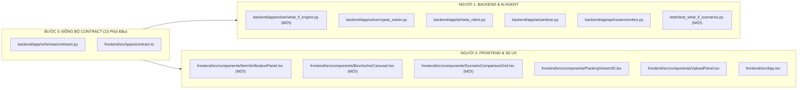
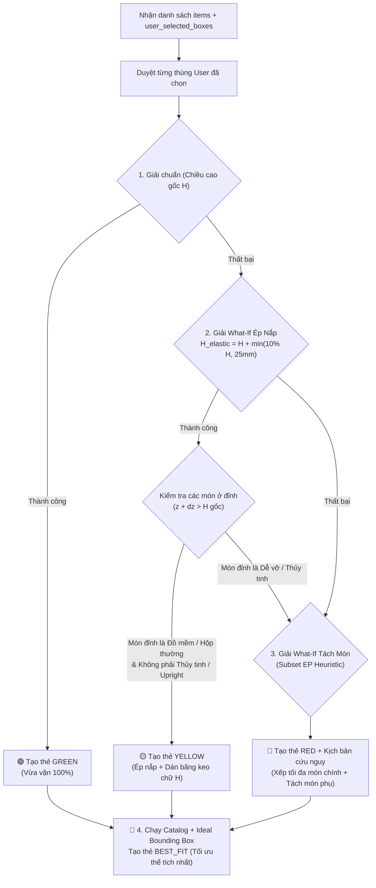

# Kế Hoạch Triển Khai Song Song OptiPack V2.0 (2 Developers: Backend & Frontend)

> [!IMPORTANT]
> **Nguyên tắc chống xung đột Git (Zero-Conflict Guarantee):**
> Kế hoạch này được thiết kế dựa trên commit mới nhất trên nhánh `main` (`76b0586`). Toàn bộ các trường dữ liệu mới đều là **Additive (chỉ thêm trường Optional có giá trị mặc định)**, giữ nguyên 100% tính tương thích ngược với 149 unit tests hiện có. Hai thành viên làm việc trên các file hoàn toàn tách biệt sau Bước 0.

---

## 0. Ma Trận Phân Quyền File (Tránh Merge Conflict 100%)



---

## 1. Bước 0: Thống Nhất Hợp Đồng Dữ Liệu Chung (Contract v1.1 - Additive)

Trước khi tách nhánh làm song song, 2 người cùng chốt và commit 2 file schema sau (chỉ mất 10–15 phút):

### 1.1. Cập nhật `backend/app/schemas/contracts.py` & `frontend/src/types/contract.ts`

1. **Bổ sung vào `PhysicalAttributes` và `PackableItem`:**
   * `material_type`: `Literal["soft_fabric", "rigid_box", "glass_ceramic", "metal_wood", "other"] = "rigid_box"`
   * `weight_tier`: `Literal["light", "medium", "heavy"] = "medium"` (Quy đổi ngầm định khi `weight_g` là `None`: `light` = $300\text{g}$, `medium` = $1000\text{g}$, `heavy` = $3000\text{g}$).

2. **Bổ sung vào `SolverConfig`:**
   * `user_selected_boxes: List[CartonSpec] = Field(default_factory=list)` — Danh sách 1–3 thùng mà người dùng đã tick chọn ở Carousel hoặc tự nhập Custom.

3. **Thêm model mới `PackingScenarioCard` vào `PackingSolutionResponse`:**
   ```python
   class PackingScenarioCard(BaseModel):
       scenario_id: str
       title: str  # VD: "Thùng của bạn #1 (32x20x12 cm)", "Phương án Tách 1 món", "Best Fit Đề xuất"
       badge_status: Literal["GREEN", "YELLOW", "RED", "BEST_FIT"]
       badge_label: str  # VD: "Vừa vặn hoàn hảo", "Ép nhẹ nắp (+1.5cm)", "Quá nhỏ - Cần tách món"
       overflow_height_mm: int = 0
       original_box_height_mm: Optional[int] = None
       top_item_name: Optional[str] = None
       ejected_item_ids: List[str] = Field(default_factory=list)
       ai_advisor_note: str = ""
       plan: Optional[PackingPlan] = None
       overflow_plans: List[PackingPlan] = Field(default_factory=list)
   ```
   * Trong `PackingSolutionResponse`, thêm trường:
     `scenarios: List[PackingScenarioCard] = Field(default_factory=list)`
   * **Lợi ích kiến trúc:** Mỗi thẻ `PackingScenarioCard` chứa sẵn đối tượng `plan: PackingPlan`. Khi người dùng click vào bất kỳ thẻ nào trên giao diện, màn hình 3D đổi mô hình **tức thì (0ms)** mà không cần gọi lại API!

---

## 2. Kế Hoạch Chi Tiết Cho Người 1: Backend, Solver What-If & ReAct Agent

### Nhiệm vụ BE-1: Nâng cấp trích xuất thuộc tính & bộ lọc an toàn
* **File sửa:** `backend/app/ai/meta_client.py` và `backend/app/ai/sanitizer.py`.
* **Logic thực hiện:**
  1. Cập nhật prompt trong `_inspect_single_crop_baseten` để Muse Spark dự đoán thêm `material_type` (`"soft_fabric"` cho túi khăn giấy/vải, `"metal_wood"` cho hộp gỗ/bình kim loại, `"glass_ceramic"` cho đồ dễ vỡ, `"rigid_box"` cho hộp carton thường) và `weight_tier`.
  2. Trong `sanitize_physical_attributes`:
     * Nếu người dùng hoặc AI gán `material_type == "glass_ceramic"` hoặc `fragility_class == "high"` $\to$ Ép cứng `stackable = False`, `max_top_load_g = 0`.
     * Nếu `weight_g is None`, gán trọng lượng ước tính theo `weight_tier` để Solver tính toán **Trọng tâm (Center of Gravity)** đặt vật nặng ở đáy hộp.

### Nhiệm vụ BE-2: Xây dựng Bộ máy Mô phỏng What-If (`what_if_engine.py`)
* **File tạo mới:** `backend/app/solver/what_if_engine.py`
* **Logic thực thi 4 kịch bản cho mỗi lần bấm "Start Packing":**



* **Công thức phân loại VÀNG vs ĐỎ chuẩn xác:**
  1. **Giới hạn dung sai chiều cao ($\Delta H_{\max}$):**
     $$\Delta H_{\max} = \min\left(\lfloor 0.10 \times H_{\text{box}} \rfloor, 25\text{ mm}\right)$$
     *(Ví dụ: Thùng cao $200\text{ mm}$ được phép nhô tối đa $20\text{ mm}$; thùng thấp $80\text{ mm}$ chỉ được phép nhô tối đa $8\text{ mm}$).*
  2. **Kiểm tra an toàn vật phẩm bị ép (Top-Layer Safety Check):**
     * Tìm tất cả các vật phẩm được đặt có tọa độ đỉnh $z + dz > H_{\text{box}}$.
     * Nếu bất kỳ vật phẩm nào trong nhóm này có `fragility_class == "high"`, `material_type == "glass_ceramic"`, hoặc `stackable == False` (do người dùng chọn "Cấm đè") $\to$ **Hủy phương án Vàng, chuyển sang Đỏ**.
  3. **Chiến lược ưu tiên khi tách món ở thẻ ĐỎ (Smart Ejection Priority):**
     * Sắp xếp độ ưu tiên giữ lại trong thùng: Đồ dễ vỡ (`high`) và đồ giá trị cao/hộp cứng được ưu tiên giữ lại bên trong thùng cứng; các món túi mềm (`soft_fabric`), kích thước cồng kềnh nhưng nhẹ, hoặc ít dễ vỡ (`low`) sẽ được ưu tiên tách ra ngoài (để đóng túi nilon/màng co riêng).

### Nhiệm vụ BE-3: Tích hợp ReAct Copilot Synthesizer (Ngôn ngữ tự nhiên)
* **File sửa:** `backend/app/ai/meta_client.py`
* **Hàm mới:** `async def generate_scenario_advisor_notes(scenarios, items) -> Dict[str, str]`
* **Cơ chế hoạt động:**
  * Gửi tóm tắt kết quả toán học của các thẻ (`GREEN`, `YELLOW`, `RED`, `BEST_FIT`) lên Baseten `muse-spark-open-1026` (timeout `5.0s`, `max_tokens=512`) để sinh lời khuyên đóng gói tự nhiên bằng tiếng Việt.
  * **Fallback tức thì (0ms):** Nếu mạng chập chờn hoặc quá 5s, hệ thống tự động dùng bộ mẫu câu thông minh có sẵn (Deterministic Template) dựa trên tên món hàng thực tế (VD: *"Cấn chiều cao 15mm tại món [TOP GIA]. Do bao bì mềm, bạn có thể ấn nhẹ nắp và dán băng keo chữ H."*). Đảm bảo API `/pack` **không bao giờ chết hay treo**.

---

## 3. Kế Hoạch Chi Tiết Cho Người 2: Frontend, Visual Carousel & 3D UX

### Nhiệm vụ FE-1: Quản lý State Machine 4 Bước trong `App.tsx`
Thiết lập biến trạng thái `currentStep: 1 | 2 | 3 | 4`:
* **Bước 1 (`currentStep = 1`):** Chụp ảnh / Chọn ảnh (Có hướng dẫn 2 góc chụp).
* **Bước 2 (`currentStep = 2`):** Kiểm tra kích thước & Xác nhận thuộc tính vật phẩm (Không thể skip).
* **Bước 3 (`currentStep = 3`):** Chọn thùng của bạn bằng Băng chuyền Vật mẫu quy chiếu (Anchor Item Carousel).
* **Bước 4 (`currentStep = 4`):** Hiển thị $N$ Ô phương án (Đỏ / Vàng / Xanh / Best Fit) + Mô phỏng 3D Step-by-Step.
* **Lưu trữ State khi chụp lại:** Lưu `userSelectedBoxes` độc lập với `analysis`. Nếu ở Bước 2 người dùng phát hiện ảnh chụp lỗi và bấm **"Chụp lại"**, khi quay lại Bước 3 các thùng người dùng từng nhập trước đó vẫn được giữ nguyên.

### Nhiệm vụ FE-2: Xây dựng `ItemVerificationPanel.tsx` (Bước 2 - Không thể Skip)
* **File tạo mới:** `frontend/src/components/ItemVerificationPanel.tsx`
* **Thiết kế giao diện:**
  * Hiển thị danh sách thẻ cho từng vật phẩm kèm ảnh crop thật (`crop_url`), tên sản phẩm (cho phép click sửa tên nếu vật bị khuất) và kích thước $L \times W \times H$.
  * Hiển thị 4 nhóm **Interactive Pill Chips** (đã được Muse Spark điền sẵn trạng thái mặc định):
    1. **Chất liệu & Độ bền:** `[🧸 Túi mềm/Vải]` | `[📦 Hộp cứng]` | `[🍷 Dễ vỡ (Thủy tinh/Gốm)]`
    2. **Chịu lực đè:** `[🧱 Đè thoải mái]` | `[📦 Chỉ đè đồ nhẹ]` | `[🚫 Cấm đè lên]`
    3. **Hướng đặt:** `[🔄 Xoay tự do]` | `[⬆️ Bắt buộc dựng đứng]`
    4. **Độ nặng:** `[🪶 Nhẹ <0.5kg]` | `[⚖️ Vừa 0.5-2kg]` | `[🏋️ Nặng >2kg]`
  * Khi người dùng chạm vào một Chip, tự động cập nhật `fragility_class`, `stackable`, `keep_upright`, `allowed_rotations` của vật phẩm đó.
  * Nút chốt dưới cùng: **`[ ✓ Xác nhận N/N vật phẩm & Tiếp tục chọn thùng → ]`**.

### Nhiệm vụ FE-3: Xây dựng `BoxAnchorCarousel.tsx` (Bước 3 - Quy chiếu thị giác)
* **File tạo mới:** `frontend/src/components/BoxAnchorCarousel.tsx`
* **Thuật toán chọn Vật mẫu (Anchor Item):**
  * Tìm vật phẩm có diện tích đáy $L \times W$ lớn nhất.
  * Hiển thị rõ trên đầu: *"Đang dùng **[Ảnh Crop] [Tên vật mẫu]** ($L \times W \times H\text{ mm}$) làm vật chuẩn để bạn ước lượng thùng:"*
* **Băng chuyền lướt ngang (Horizontal Snap Carousel):**
  * Tự động sinh 4 cỡ thùng dựa trên kích thước vật mẫu và các thùng chuẩn đời sống:
    * **Cỡ 1 (Vừa khít vật mẫu):** Chiều dài thùng $\approx 1.25 \times L_{\text{anchor}}$ (Vật chiếm $80\%$ thùng).
    * **Cỡ 2 (Cỡ hộp giày / COD Vừa):** Chiều dài thùng $\approx 2.0 \times L_{\text{anchor}}$ (Vật chiếm đúng **$1/2$ chiều dài thùng**).
    * **Cỡ 3 (Cỡ thùng mì tôm):** Chiều dài thùng $\approx 3.0 \times L_{\text{anchor}}$ (Vật chiếm $1/3$ thùng).
    * **Cỡ 4 (Thùng lớn):** Chiều dài thùng $\approx 4.0 \times L_{\text{anchor}}$.
  * **Bản vẽ SVG 2.5D Trực quan:**
    * Dùng SVG phép chiếu Isometric/Top-down (không méo góc).
    * Giữ kích thước hiển thị của Vật mẫu cố định ở góc trái dưới của thùng, dán ảnh `crop_url` lên mặt vật mẫu. Khung viền nét đứt của thùng to dần ra khi người dùng lướt qua phải.
  * Mỗi thẻ có nút `[ ✓ Tôi có thùng cỡ này ]` (Cho phép chọn nhiều thùng) + Tab `[ 📐 Tự nhập số đo thùng ]`.

### Nhiệm vụ FE-4: Xây dựng `ScenarioComparisonGrid.tsx` & Nâng cấp 3D (Bước 4)
* **File tạo mới:** `frontend/src/components/ScenarioComparisonGrid.tsx`
* **File sửa:** `frontend/src/components/PackingViewer3D.tsx`
* **Logic hiển thị:**
  * Hiển thị hàng ngang các thẻ `PackingScenarioCard` trả về từ Backend:
    * Thẻ 🟢 **XANH**: Viền xanh lá, hiển thị độ lấp đầy $\%$, chi phí dự kiến.
    * Thẻ 🟡 **VÀNG**: Viền vàng cam, badge *"Ép nhẹ nắp +X mm"*, hiển thị lời khuyên dán băng keo chữ H của AI.
    * Thẻ 🔴 **ĐỎ**: Viền đỏ, hiển thị món cần tách ra ngoài + cách bọc chống sốc, kèm nút xem 3D của các món còn lại trong thùng.
    * Thẻ 🔵 **BEST FIT**: Viền xanh dương nổi bật kèm ngôi sao *"Chuẩn tối ưu hệ thống"*.
  * **Hiệu ứng 3D đặc biệt cho Thẻ Vàng trong `PackingViewer3D.tsx`:**
    * Khi phương án đang chọn có `badge_status === "YELLOW"`, vẽ thêm khung viền nét đứt màu vàng cam tại cao độ nắp thùng gốc (`original_box_height_mm`) để người dùng thấy rõ phần nhô lên vài milimet của gói hàng mềm và yên tâm đóng gói!

---

## 4. Danh Sách Các Edge Cases & Biện Pháp Phòng Ngừa Bug

| STT | Tình huống Edge Case | Nguy cơ gây lỗi | Cách xử lý triệt để trong kế hoạch |
| :--- | :--- | :--- | :--- |
| **1** | **Vật mẫu (Anchor Item) là vật siêu dài nhưng dẹt** (VD: cây thước, chiếc ô $400 \times 30 \times 30\text{ mm}$) | Nếu nhân $2\times, 3\times$ chiều dài sẽ ra chiếc thùng dài $1.2\text{ mét}$ phi thực tế. | Chọn Anchor Item theo diện tích đáy $\max(L \times W)$ nhưng giới hạn tỷ lệ khung hình thùng gợi ý trong khoảng $L/W \in [1.2, 1.8]$. |
| **2** | **Người dùng không chọn thùng nào ở Bước 3 mà bấm Continue** | Mảng `user_selected_boxes` rỗng làm Solver không biết giải thùng nào. | Nếu người dùng không tick thùng nào, nút Continue tự động chuyển thành *"Dùng thùng Best Fit của hệ thống"* và trả về phương án tối ưu mặc định. |
| **3** | **Tất cả các món đều là đồ dễ vỡ (`fragility = high`) và không được đè (`stackable = False`)** | Không món nào chồng lên món nào được, mọi thùng hẹp đáy đều báo `INFEASIBLE`. | Solver tự động xếp trải phẳng 1 lớp (Single-layer floor packing) và Agent giải thích rõ: *"Do tất cả đồ đều cấm đè, cần thùng có đáy rộng hoặc chia làm 2 hộp."* |
| **4** | **Người dùng nhập kích thước thùng bằng đơn vị `cm` thay vì `mm`** (VD: nhập `30 x 20 x 15` thay vì `300 x 200 x 150`) | Thùng dài $30\text{ mm}$ ($3\text{ cm}$) không chứa vừa bất kỳ món nào. | Giao diện Bước 3 hiển thị rõ đơn vị nhập là **`cm`** (người dùng đời thực quen dùng `cm`), sau đó Frontend tự nhân $\times 10$ sang `mm` trước khi gửi xuống Backend! |
| **5** | **Mất kết nối mạng tới Baseten / Meta API ở Bước 4** | Quá trình tạo lời khuyên AI bị treo hoặc văng lỗi HTTP 500. | Bọc `generate_scenario_advisor_notes` trong `try...except` với timeout cứng `5.0s`, tự động fallback sang mẫu câu tiếng Việt định sẵn từ thông số toán học của Solver. |

---

## 5. Trình Tự Ghép Code (Integration Sequence)

1. **Giờ 1:** Cùng chốt **Bước 0** (`contracts.py` & `contract.ts`) và push lên `main`.
2. **Giờ 2 – Giờ 4 (Làm song song 100%):**
   * **Backend:** Viết `what_if_engine.py`, nối vào `/api/v1/orders/pack` và viết test trong `tests/test_what_if_scenarios.py`.
   * **Frontend:** Viết `ItemVerificationPanel.tsx`, `BoxAnchorCarousel.tsx`, `ScenarioComparisonGrid.tsx` (có thể test độc lập với mock data từ `contract.ts`).
3. **Giờ 5:** Merge cả hai nhánh vào `main`, chạy kiểm thử End-to-End từ lúc tải ảnh $\to$ Xác nhận thuộc tính $\to$ Lướt chọn thùng $\to$ Xem các ô Đỏ/Vàng/Xanh $\to$ Kéo thanh trượt 3D.

