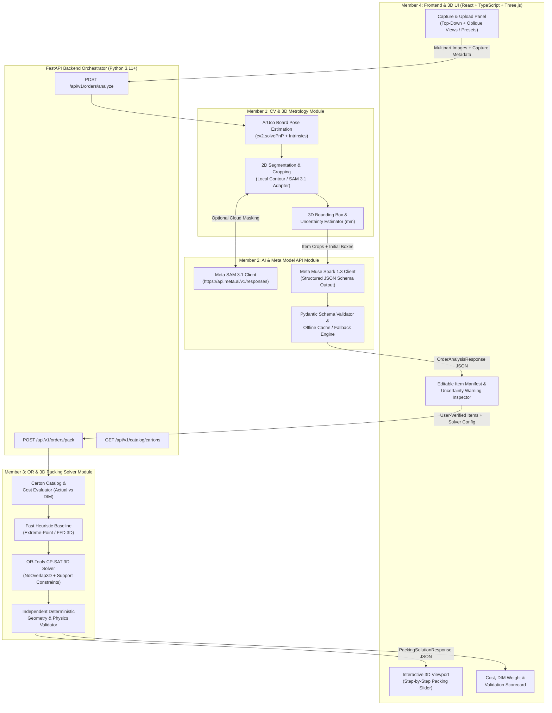

# OptiPack — Master Technical Implementation Specification (`01_PROJECT_SPEC.md`)

- **Official Project Name:** OptiPack *(formerly evaluated as "PackPulse 3D" in the historical research report `packpulse_3d_due_diligence_report.md`)*
- **Document Role:** Single Source of Truth — Shared Architecture, Scope, Data Contracts, Coordinate Conventions, and Acceptance Criteria
- **Intended Audience:** All Team Members (Members 1, 2, 3, and 4)
- **Status:** Baseline v1.0.0 (`Contract v1.0.0`)

---

## 1. Executive Summary & Project Rename

**OptiPack** is a rapid-turnaround hackathon MVP designed for **e-commerce multi-item cartonization**: given an order containing multiple distinct items captured in a controlled packing-station setup, OptiPack detects and identifies the items, estimates their 3D bounding dimensions with explicit measurement uncertainty, extracts visible packaging/handling semantics via the **Meta Model API**, selects a cost-optimal shipping carton from a finite catalog using a **3D Bin Packing & Cartonization Solver**, validates the resulting 3D geometry deterministically, and renders an interactive step-by-step **3D packing visualization** with inline manual override capabilities.

> **Historical Context Note:** During the initial technical due diligence phase (`packpulse_3d_due_diligence_report.md`), the original concept was evaluated under the working title *PackPulse 3D*. Based on the due diligence findings, the team narrowed the product scope from arbitrary warehouse palletization and unconstrained spatial video reconstruction to a rigorously bounded **E-Commerce Multi-Item Cartonization MVP** and officially renamed the project **OptiPack**. The legacy name *PackPulse 3D* is retained strictly when referencing the historical due diligence report.

### Evidence & Decision Status Taxonomy

To prevent unverified hypotheses from being treated as settled engineering facts, every technical assertion, architectural choice, and parameter across the OptiPack specification suite carries one of five explicit status tags:

- **`[Verified]`**: Directly confirmed from official documentation (e.g., [Meta Developer Documentation](https://dev.meta.ai/docs/overview)), peer-reviewed literature, projective geometry principles, or tested library behavior (e.g., [Google OR-Tools CP-SAT](https://developers.google.com/optimization/cp/cp_solver)).
- **`[Proposed]`**: Recommended design choice for the OptiPack MVP based on engineering tradeoffs and prior art analysis.
- **`[Needs Validation]`**: Technical hypothesis or target threshold that must be empirically tested during **Phase 0 Proof-of-Feasibility Experiments** before full integration.
- **`[Unverified]`**: Claims lacking empirical evidence in our environment; must not be assumed true without testing or user input.
- **`[Fallback]`**: Pre-defined engineering downgrade path that activates automatically or by team decision if a primary `[Needs Validation]` approach fails its Phase 0 gate.

---

## 2. Problem Definition, Target User Workflow & Product Scope

### 2.1 Core Problem & Cost-Driven Objective

In e-commerce fulfillment, multi-item orders (typically 2 to 8 items per order) suffer from suboptimal box selection ("shipping air"). Major parcel carriers (UPS, FedEx, DHL, USPS) bill shipments based on the greater of **Actual Gross Weight** and **Dimensional (DIM) Weight**:

$$\text{DIM Weight (kg)} = \frac{L_{\text{ext, cm}} \times W_{\text{ext, cm}} \times H_{\text{ext, cm}}}{D_{\text{DIM}}}$$

where $D_{\text{DIM}}$ is the carrier's dimensional divisor (standard commercial divisor: $5000\text{ cm}^3/\text{kg}$, equivalent to $5\times 10^6\text{ mm}^3/\text{kg}$) `[Verified]`.

> **Critical Product Insight (`[Verified]`):** Maximizing volumetric utilization inside a chosen carton does **not** automatically minimize total shipping cost. Selecting a slightly less dense carton that drops the order into a lower billable weight tier—or recognizing when splitting an order across two small cartons costs less than one oversized carton—directly drives financial savings. Therefore, OptiPack's primary optimization objective is minimizing **Total Packaging & Shipping Cost ($\text{USD}$)** across a finite carton catalog, with volumetric utilization and center-of-mass lowering serving as secondary tie-breaking objectives `[Proposed]`.

### 2.2 End-to-End User Workflow

1. **Order Capture (Step 1):** The packing operator places the items belonging to an order onto a flat packing table alongside a standard **Calibration Reference Sheet** (A4 sheet printed with 4 corner ArUco fiducial markers) under the defined capture procedure (1 top-down zenith photo + 1 oblique $35^\circ\text{--}45^\circ$ photo, or a short 3–5 second dual-angle clip sampled into keyframes).
2. **Perception & Metrology (Step 2 — Member 1):** The CV pipeline detects the ArUco calibration board, computes the camera pose (`cv2.solvePnP`), segments individual items (via local contour/grabcut or Meta `sam-3.1` masks), and estimates each item's 3D bounding box $(L, W, H)$ in millimeters (`mm`) along with a numerical confidence score and uncertainty margin $(\pm\sigma\text{ mm})$.
3. **Semantic & Handling Extraction (Step 3 — Member 2):** The AI service calls the Meta Model API (`muse-spark-1.3`) with the scene image and item crops to classify item packaging type, read visible handling labels (*"Fragile"*, *"This Side Up"*), and propose conservative handling flags (`keep_upright`, `fragility_class`, `stackable`), while explicitly marking unobservable physical properties (such as exact weight or internal fragility of unmarked opaque boxes) as `"unknown"` / `null`.
4. **Human-in-the-Loop Verification & Override (Step 4 — Member 4):** Before or alongside packing optimization, the frontend presents an editable **Item Manifest Table**. Any item with high dimensional uncertainty ($\sigma > 8\text{ mm}$), fallback height estimation, or `"unknown"` weight/fragility is highlighted with a warning badge so the operator can confirm or edit dimensions, weight, orientation constraints, or load-bearing rules in 1 click.
5. **Carton Selection & 3D Bin Packing (Step 5 — Member 3):** The solver evaluates candidate cartons from the finite catalog, filters out cartons that violate volume, dimension, or max-weight limits, and solves for a conflict-free, vertically supported 3D arrangement that minimizes total packaging + shipping cost (using a fast deterministic First-Fit Decreasing / Extreme-Point heuristic baseline and an **OR-Tools CP-SAT** optimizer).
6. **Independent Deterministic Validation (Step 6 — Member 3):** An independent geometry validator verifies zero pairwise AABB overlap, strict containment within internal carton bounds, valid allowed rotation codes, vertical support coverage ($\ge 60\%$ base area supported), fragility stacking rules, and gross weight limits.
7. **Interactive 3D Packing Guide (Step 7 — Member 4):** The frontend renders the selected carton and items in an interactive Three.js / React Three Fiber 3D viewport with a **Step-by-Step Packing Slider** (showing the operator which item to place first, second, third, etc.), a cost & utilization scorecard, and actionable diagnostics if an order cannot fit into a single carton.

### 2.3 MVP Scope Boundaries

| Scope Dimension | In Scope for OptiPack MVP (`[Proposed]`) | Out of Scope (`[Verified]` Constraint) |
| :--- | :--- | :--- |
| **Order Profile** | E-commerce multi-item orders containing **2 to 8 distinct items** (up to 12 items max stress test). | Full warehouse palletization ($50\text{--}500+$ boxes), container loading, or continuous conveyor belts. |
| **Test Item Catalog** | **5 to 10 relatively rigid items** (rectangular cartons, boxed electronics, cosmetics boxes, rigid bottles/cylinders approximated by bounding prisms). | Deformable apparel bags without bounding structure, loose liquids, irregular plush toys, or entangled cables. |
| **Capture Environment** | Controlled tabletop workspace with a printed **A4 4-ArUco Calibration Sheet**, well-lit indoor lighting, non-overlapping item placement. | Uncalibrated in-the-wild handheld walking videos, heavy inter-object occlusion, or markerless scale estimation. |
| **Carton Catalog** | Finite catalog of **5 standard e-commerce corrugated cartons** (`BOX-S` through `BOX-XXL`) with explicit dimensions, tare weights, and costs. | Custom on-demand box-making machines or infinite continuous box sizing. |
| **Physics & Stability** | Rigid Axis-Aligned Bounding Boxes (AABBs), 6 orthogonal rotations, static vertical base support ($\ge 60\%$), heuristic fragility/stacking tiers. | Finite-element crush simulation, dynamic vibration/drop testing, friction coefficients, or robotic grasp planning. |
| **Manual Fallback** | Full inline UI editing of item dimensions $(L, W, H)$, weight, fragility, upright lock, and manual item addition/removal. | Fully autonomous zero-touch lights-out warehouse execution without human oversight. |

---

## 3. System Architecture & Component Boundaries

### 3.1 High-Level Architecture Diagram



### 3.2 Module Ownership & Boundaries

| Module ID | Owner | Primary Directory | Responsibility | Upstream Inputs | Downstream Outputs |
| :--- | :--- | :--- | :--- | :--- | :--- |
| **`cv_metrology`** | **Member 1** | `backend/app/cv/` | Camera calibration (`solvePnP`), ArUco reference detection, item segmentation/isolation, 3D bounding box estimation $(L, W, H)$ in `mm`, uncertainty quantification $(\pm\sigma\text{ mm})$. | Raw RGB image(s) (`top_view`, optional `oblique_view`), calibration sheet spec, optional `sam-3.1` RLE masks from Member 2. | `List[DetectedItemMeasurement]` containing pixel boxes, crops, `dimensions_mm`, `uncertainty_mm`, `measurement_method`, and `confidence`. |
| **`ai_meta_api`** | **Member 2** | `backend/app/ai/` | Meta Model API authentication, `/v1/responses` integration for `muse-spark-1.3` (structured JSON semantic extraction) and `sam-3.1` (text-prompted segmentation), rate-limit/retry handling, schema sanitization, offline mock cache. | Scene RGB image, cropped item images from Member 1, CV dimension priors. | `List[SemanticItemAttributes]` validated against strict Pydantic schema, plus API latency/fallback telemetry. |
| **`or_solver`** | **Member 3** | `backend/app/solver/` | Carton catalog management, shipping cost evaluation (Actual vs. DIM weight), fast heuristic baseline packer, OR-Tools CP-SAT exact/bounded solver, multi-carton fallback, and **Independent Deterministic Geometry Validator**. | `PackingRequest` (list of `PackableItem` in `mm`, carton catalog, objective weights, time limit). | `PackingSolutionResponse` (selected carton, 3D item placements with rotations and step order, cost breakdown, and `ValidationReport`). |
| **`frontend_ui`** | **Member 4** | `frontend/src/` | Capture/upload workflow, 2D detection overlay, editable Item Manifest table with uncertainty warnings, interactive Three.js 3D packing viewer with step-by-step slider, cost/utilization dashboard, error/infeasibility UI. | `OrderAnalysisResponse` from `/api/v1/orders/analyze` and `PackingSolutionResponse` from `/api/v1/orders/pack`. | User edits/overrides submitted as `PackingRequest`; interactive visual demonstration for judges/operators. |

---

## 4. Canonical Shared Conventions (Units, Coordinates, Orientations)

> **MANDATORY RULE FOR ALL TEAM MEMBERS:** Every module must adhere strictly to the units, coordinate axes, anchor points, and rotation codes defined in this section. Any conversion (such as Three.js $Y$-up rendering in Member 4's frontend) must happen exclusively inside a dedicated boundary adapter function.

### 4.1 Units of Measurement (`[Verified]` Contract)

- **Linear Dimensions & Coordinates (`length_mm`, `width_mm`, `height_mm`, `x`, `y`, `z`):** **Millimeters (`mm`) represented as positive integers (`int`)** across all solver inputs, placements, and carton definitions. (Member 1's floating-point sub-millimeter estimates are rounded to the nearest integer millimeter `int(round(val_mm))` at the CV output boundary, while uncertainty $\sigma$ may be stored as `float` or `int` in `mm`).
- **Mass / Weight (`weight_g`):** **Grams (`g`) represented as positive integers (`int`)**, or `null` if unknown.
- **Volume (`volume_cm3` / `volume_mm3`):** Internal computation uses $\text{mm}^3$ (`int`); UI display converts to $\text{cm}^3$ or Liters ($\text{L} = 10^6\text{ mm}^3$).
- **Currency (`cost_usd`):** **US Dollars (`USD`) represented as `float`** rounded to 2 decimal places.
- **Time / Latency (`latency_ms`, `solver_time_limit_ms`):** **Milliseconds (`ms`) represented as `int`**.

### 4.2 Canonical 3D Coordinate System (Right-Handed, $Z$-Up)

All backend modules (Member 1 CV World Frame, Member 3 Solver Frame, and JSON API contracts) use a **Right-Handed, $Z$-Up Cartesian Coordinate System**:

- **Origin $(0, 0, 0)$:**
  - *In Capture / Calibration Space (Member 1):* Bottom-left outer corner of the A4 ArUco reference board lying flat on the table surface ($Z = 0$).
  - *In Carton Packing Space (Member 3 & API Contract):* **Front-Left-Bottom internal corner** of the carton.
- **$+X$ Axis (`length` axis):** Runs horizontally from **Left to Right** along the carton's internal length $L_{\text{carton}}$ ($0 \le x \le L_{\text{carton}}$).
- **$+Y$ Axis (`width` / depth axis):** Runs horizontally from **Front to Back** along the carton's internal width $W_{\text{carton}}$ ($0 \le y \le W_{\text{carton}}$).
- **$+Z$ Axis (`height` / vertical axis):** Runs vertically **Upward** against gravity along the carton's internal height $H_{\text{carton}}$ ($0 \le z \le H_{\text{carton}}$). Gravity acts in the $-Z$ direction $\mathbf{g} = (0, 0, -g)$.

### 4.3 Item Placement Anchor Point Convention

- Every placed item's `position_mm: {"x": x_min, "y": y_min, "z": z_min}` represents its **Minimum Corner** (i.e., the Front-Left-Bottom corner of that item's rotated Axis-Aligned Bounding Box).
- Given placed dimensions `placed_dimensions_mm: {"dx": dx, "dy": dy, "dz": dz}`, the item occupies the closed 3D interval:
  $$[x_{\min},\, x_{\min} + dx] \times [y_{\min},\, y_{\min} + dy] \times [z_{\min},\, z_{\min} + dz]$$
- The item's geometric center in canonical $Z$-up coordinates is:
  $$\left(x_{\min} + \frac{dx}{2},\; y_{\min} + \frac{dy}{2},\; z_{\min} + \frac{dz}{2}\right)$$

### 4.4 Canonical 6 Orthogonal Rotations (`rotation_code` Enum)

Every item has canonical unrotated dimensions $(L, W, H)$ corresponding to `(length_mm, width_mm, height_mm)` in its natural upright resting state on the table, where $L \ge W$ by convention. When placed inside a carton, an item may take one of **6 axis-aligned orthogonal orientations**, identified by a deterministic 3-letter `rotation_code` indicating which canonical item dimension aligns with the carton's $(X, Y, Z)$ axes:

| `rotation_code` | Carton $X$ (`dx`) | Carton $Y$ (`dy`) | Carton $Z$ (`dz`) | Physical Description | Allowed when `keep_upright == true`? |
| :--- | :---: | :---: | :---: | :--- | :---: |
| **`"LWH"`** | $L$ | $W$ | $H$ | Default upright orientation ($0^\circ$ yaw) | **Yes** |
| **`"WLH"`** | $W$ | $L$ | $H$ | Upright orientation rotated $90^\circ$ around vertical $Z$ axis | **Yes** |
| **`"LHW"`** | $L$ | $H$ | $W$ | Pitched onto front/back side ($H$ along $Y$, $W$ vertical) | No |
| **`"HLW"`** | $H$ | $L$ | $W$ | Pitched onto side and yawed $90^\circ$ ($W$ vertical) | No |
| **`"WHL"`** | $W$ | $H$ | $L$ | Tipped onto end ($L$ vertical) | No |
| **`"HWL"`** | $H$ | $W$ | $L$ | Rolled onto side ($L$ vertical) | No |

---

## 5. Standard Carton Catalog & Shipping Cost Model

### 5.1 Standard E-Commerce Carton Catalog (`[Proposed]` Baseline)

All dimensions are **internal usable dimensions** in millimeters (`mm`). Wall thickness is assumed to be $3\text{ mm}$ per side ($+6\text{ mm}$ per axis for external DIM calculation, or external dimensions equal internal dimensions within tolerance for standard single-wall corrugated mailers). For deterministic simplicity across all modules, the DIM weight calculation uses the catalog dimensions directly with $D_{\text{DIM}} = 5,000,000\text{ mm}^3/\text{kg}$ ($5000\text{ cm}^3/\text{kg}$).

| `carton_id` | Display Name | Internal $L\times W\times H$ (`mm`) | Internal Volume ($\text{cm}^3$) | Tare Weight (`g`) | Max Payload (`g`) | Box Material Cost (`USD`) | DIM Weight ($\text{kg}$) |
| :--- | :--- | :---: | :---: | :---: | :---: | :---: | :---: |
| **`BOX-S`** | Small Mailer Box | $200 \times 150 \times 100$ | $3,000$ | $85$ | $3,000$ | $\$0.45$ | $0.60\text{ kg}$ |
| **`BOX-M`** | Medium Standard Carton | $300 \times 220 \times 150$ | $9,900$ | $160$ | $8,000$ | $\$0.85$ | $1.98\text{ kg}$ |
| **`BOX-L`** | Large E-Commerce Carton | $400 \times 300 \times 200$ | $24,000$ | $280$ | $15,000$ | $\$1.40$ | $4.80\text{ kg}$ |
| **`BOX-XL`** | Extra-Large Fulfillment Box | $500 \times 350 \times 250$ | $43,750$ | $420$ | $20,000$ | $\$2.10$ | $8.75\text{ kg}$ |
| **`BOX-XXL`** | Heavy Bulk Master Carton | $600 \times 400 \times 350$ | $84,000$ | $650$ | $25,000$ | $\$3.20$ | $16.80\text{ kg}$ |

### 5.2 Explicit Packaging & Shipping Cost Function (`[Proposed]`)

For a candidate carton $c$ containing a set of packed items $I_c$:

1. **Actual Gross Weight ($\text{kg}$):**
   $$W_{\text{actual}}(c, I_c) = \frac{\text{tare\_weight\_g}(c) + \sum_{i \in I_c} \text{effective\_weight\_g}(i)}{1000.0}$$
   *(Note: If an item's `weight_g` is `null` / unknown and not overridden by the user, the solver uses a conservative density-based fallback estimate $\rho_{\text{default}} = 0.25\text{ g/cm}^3$ and flags `weight_assumed: true` in the response warnings.)*
2. **Dimensional (DIM) Weight ($\text{kg}$):**
   $$W_{\text{DIM}}(c) = \frac{L_c \times W_c \times H_c}{5,000,000.0}$$
3. **Billable Weight ($\text{kg}$):**
   $$W_{\text{billable}}(c, I_c) = \max\Big(W_{\text{actual}}(c, I_c),\; W_{\text{DIM}}(c)\Big)$$
4. **Shipping Rate Schedule:**
   $$C_{\text{shipping}}(c, I_c) = C_{\text{base}} + r_{\text{kg}} \cdot \lceil 2 \cdot W_{\text{billable}}(c, I_c) \rceil / 2.0$$
   where $C_{\text{base}} = \$3.50\text{ USD}$ base parcel handling fee and $r_{\text{kg}} = \$1.20\text{ USD per kg}$ (billed in $0.5\text{ kg}$ increments).
5. **Void Fill Cost Estimate:**
   $$V_{\text{void}}(c, I_c) = \max\left(0,\; L_c W_c H_c - \sum_{i \in I_c} L_i W_i H_i\right)$$
   $$C_{\text{void}}(c, I_c) = r_{\text{void}} \cdot \frac{V_{\text{void}}(c, I_c)}{1,000,000.0}$$
   where $r_{\text{void}} = \$0.04\text{ USD per Liter}$ ($10^6\text{ mm}^3$) of empty void requiring air pillows or kraft paper.
6. **Total Objective Cost ($\text{USD}$):**
   $$C_{\text{total}}(c, I_c) = C_{\text{box}}(c) + C_{\text{shipping}}(c, I_c) + C_{\text{void}}(c, I_c)$$

---

## 6. Shared Interface & Data Contracts (`Contract v1.0.0`)

All REST endpoints are served by the FastAPI backend under `/api/v1` and exchange UTF-8 JSON conforming strictly to the schemas below.

### 6.1 Endpoint 1: `POST /api/v1/orders/analyze` (CV + AI Pipeline)

Accepts `multipart/form-data` with:
- `top_image` (file, required): RGB image (`.jpg` / `.png`) taken from roughly top-down angle showing the A4 ArUco reference board and items.
- `oblique_image` (file, optional): RGB image (`.jpg` / `.png`) taken from $30^\circ\text{--}45^\circ$ elevation angle for multi-view height triangulation.
- `capture_mode` (string, default `"dual_photo"`): `"dual_photo" | "single_top_photo" | "demo_preset"`.
- `enable_cloud_sam` (boolean, default `false`): Whether to invoke Meta `sam-3.1` cloud segmentation in addition to local OpenCV segmentation.
- `enable_muse_semantics` (boolean, default `true`): Whether to invoke Meta `muse-spark-1.3` for semantic extraction.

#### Response Payload: `OrderAnalysisResponse`

```json
{
  "contract_version": "1.0.0",
  "analysis_id": "ord_20261027_001",
  "timestamp_utc": "2026-10-27T14:22:10Z",
  "calibration": {
    "status": "calibrated",
    "reference_type": "a4_aruco_4corner",
    "detected_markers_count": 4,
    "reprojection_error_px": 0.84,
    "scale_mm_per_px_at_z0": 0.412,
    "camera_pose_valid": true,
    "warnings": []
  },
  "items": [
    {
      "item_id": "item_01",
      "display_name": "Wireless Headphones Retail Box",
      "category": "electronics_boxed",
      "quantity": 1,
      "dimensions_mm": {
        "length_mm": 210,
        "width_mm": 165,
        "height_mm": 95
      },
      "uncertainty_mm": {
        "length_sigma_mm": 3.2,
        "width_sigma_mm": 2.9,
        "height_sigma_mm": 4.5,
        "safety_margin_mm": 5
      },
      "measurement_provenance": {
        "xy_method": "aruco_plane_raycast",
        "z_method": "dual_view_pnp_triangulation",
        "confidence_score": 0.91,
        "requires_user_review": false
      },
      "physical_attributes": {
        "weight_g": null,
        "weight_source": "unknown",
        "fragility_class": "medium",
        "fragility_source": "ai_inferred_packaging",
        "keep_upright": false,
        "orientation_source": "default_unconstrained",
        "stackable": true,
        "max_top_load_g": 2000,
        "visible_labels": ["CE", "Li-ion Battery"]
      },
      "allowed_rotations": ["LWH", "WLH", "LHW", "HLW", "WHL", "HWL"],
      "visual_evidence": {
        "bbox_2d_px": [310, 220, 820, 620],
        "crop_url": "/api/v1/assets/crops/ord_20261027_001_item_01.jpg",
        "mask_rle": null,
        "display_color_hex": "#3B82F6"
      }
    }
  ],
  "ai_telemetry": {
    "sam_status": "skipped",
    "muse_model": "muse-spark-1.3",
    "muse_status": "success",
    "muse_latency_ms": 1420,
    "fallback_activated": false
  },
  "global_warnings": [
    "Item 'item_01' weight is unknown (cannot be determined from visual appearance). Default density estimate (520g) will be used unless overridden."
  ]
}
```

### 6.2 Endpoint 2: `POST /api/v1/orders/pack` (Solver + Deterministic Validator)

Accepts `application/json` containing user-reviewed items and solver configuration:

#### Request Payload: `PackingRequest`

```json
{
  "contract_version": "1.0.0",
  "analysis_id": "ord_20261027_001",
  "solver_config": {
    "mode": "cpsat_with_heuristic_fallback",
    "time_limit_ms": 3000,
    "apply_uncertainty_margin": true,
    "min_support_ratio": 0.60,
    "allow_multi_carton_split": true
  },
  "items": [
    {
      "item_id": "item_01",
      "display_name": "Wireless Headphones Retail Box",
      "quantity": 1,
      "dimensions_mm": {
        "length_mm": 210,
        "width_mm": 165,
        "height_mm": 95
      },
      "safety_margin_mm": 5,
      "weight_g": 480,
      "weight_assumed": false,
      "fragility_class": "medium",
      "keep_upright": false,
      "stackable": true,
      "max_top_load_g": 2000,
      "allowed_rotations": ["LWH", "WLH", "LHW", "HLW", "WHL", "HWL"],
      "display_color_hex": "#3B82F6"
    }
  ]
}
```

#### Response Payload: `PackingSolutionResponse`

```json
{
  "contract_version": "1.0.0",
  "status": "OPTIMAL",
  "solver_used": "ortools_cpsat",
  "solve_time_ms": 412,
  "single_carton_feasible": true,
  "primary_plan": {
    "plan_index": 1,
    "carton": {
      "carton_id": "BOX-M",
      "display_name": "Medium Standard Carton",
      "internal_dimensions_mm": {
        "length_mm": 300,
        "width_mm": 220,
        "height_mm": 150
      },
      "tare_weight_g": 160,
      "max_payload_g": 8000,
      "box_cost_usd": 0.85
    },
    "metrics": {
      "volume_utilization_pct": 68.4,
      "total_items_packed": 3,
      "actual_gross_weight_kg": 1.42,
      "dim_weight_kg": 1.98,
      "billable_weight_kg": 2.00,
      "box_cost_usd": 0.85,
      "void_fill_cost_usd": 0.12,
      "shipping_cost_usd": 5.90,
      "total_estimated_cost_usd": 6.87,
      "center_of_mass_mm": {
        "x": 142.0,
        "y": 108.0,
        "z": 54.0
      }
    },
    "placements": [
      {
        "step_number": 1,
        "item_id": "item_01",
        "display_name": "Wireless Headphones Retail Box",
        "rotation_code": "LWH",
        "position_mm": {
          "x": 0,
          "y": 0,
          "z": 0
        },
        "placed_dimensions_mm": {
          "dx": 215,
          "dy": 170,
          "dz": 100
        },
        "nominal_dimensions_mm": {
          "dx": 210,
          "dy": 165,
          "dz": 95
        },
        "support_ratio": 1.0,
        "supported_by_item_ids": ["CARTON_FLOOR"],
        "display_color_hex": "#3B82F6"
      }
    ],
    "validation": {
      "is_valid": true,
      "boundary_check_passed": true,
      "overlap_check_passed": true,
      "rotation_check_passed": true,
      "support_check_passed": true,
      "fragility_check_passed": true,
      "weight_check_passed": true,
      "violations": [],
      "warnings": []
    }
  },
  "overflow_plans": [],
  "unpacked_item_ids": [],
  "infeasibility_diagnostics": null,
  "candidate_carton_comparison": [
    {
      "carton_id": "BOX-S",
      "feasible": false,
      "rejection_reason": "Total item volume (6,770 cm3) exceeds BOX-S internal volume (3,000 cm3)."
    },
    {
      "carton_id": "BOX-M",
      "feasible": true,
      "total_estimated_cost_usd": 6.87,
      "volume_utilization_pct": 68.4,
      "selected": true
    },
    {
      "carton_id": "BOX-L",
      "feasible": true,
      "total_estimated_cost_usd": 10.69,
      "volume_utilization_pct": 28.2,
      "selected": false
    }
  ]
}
```

---

## 7. End-to-End Acceptance Criteria

For the OptiPack MVP to pass integration review before the final pitch demonstration:

1. **Calibration & Measurement Gate (`Member 1`):** Given a compliant top-down + oblique image pair of 3–6 test items on the A4 ArUco reference board, `/api/v1/orders/analyze` returns integer millimeter dimensions within $\pm 8\text{ mm}$ MAE on planar footprint $(L, W)$ and $\pm 12\text{ mm}$ MAE on height $H$ (or cleanly activates manual/prior height fallback with `requires_user_review: true`).
2. **AI Schema & Safety Gate (`Member 2`):** Every call to Meta `muse-spark-1.3` returns a valid `OrderAnalysisResponse` within $4.0\text{ seconds}$ (P95), never fabricates numerical weights from visual appearance alone, and automatically falls back to deterministic local defaults within $500\text{ ms}$ if the Meta API returns an error or times out.
3. **Solver & Deterministic Validator Gate (`Member 3`):** For any order of up to 8 items, `/api/v1/orders/pack` returns a solution in $\le 3.0\text{ seconds}$ where `validation.is_valid == true` (0% pairwise AABB overlap, 100% containment within carton bounds, $\ge 60\%$ vertical support ratio per elevated item, and lowest `total_estimated_cost_usd` among feasible cartons).
4. **Interactive 3D UI & Override Gate (`Member 4`):** The frontend renders the 3D carton and all packed items with exact geometric alignment (zero floating or clipping boxes), allows stepping through placements $1 \dots N$ via a slider, and enables editing any item's dimensions or orientation constraint and re-solving end-to-end in $< 3.5\text{ seconds}$.

---

## 8. Summary of Verified vs. Proposed vs. Needs Validation vs. Fallback Choices

| Subsystem / Topic | `[Verified]` Fact | `[Proposed]` MVP Design | `[Needs Validation]` (Phase 0 Gate) | `[Fallback]` Mechanism |
| :--- | :--- | :--- | :--- | :--- |
| **Scale & 3D Measurement** | Planar homography (`getPerspectiveTransform`) causes parallax error $\Delta L = H\cot\theta$ on 3D objects of height $H > 0$. | A4 sheet with 4 corner ArUco markers + `cv2.solvePnP` camera pose + dual-view ray triangulation for height $H$. | Achieve $\le 10\text{ mm}$ MAE across 5 test items using smartphone photos in Phase 0. | Single top-down photo for $(L, W)$ + monocular depth / catalog lookup / inline manual slider for $H$. |
| **Segmentation (`sam-3.1`)** | Meta `sam-3.1` API accepts 1 short noun phrase per request (`$2.50/1k` images) and outputs custom `<\|box...\|><\|mask...\|>` stream tokens; no point/box prompt in cloud API. | Use local OpenCV contour/GrabCut on high-contrast tabletop as primary fast segmenter; offer `sam-3.1` single-concept prompt (`"package"`) as cloud option. | Verify Python regex/1-bit mask decoder and latency ($< 2.5\text{ s}$) on live `/v1/responses` endpoint. | Pure OpenCV adaptive threshold + morphological watershed segmentation on tabletop background. |
| **Multimodal Reasoning (`muse-spark-1.3`)** | `muse-spark-1.3` is GA (`3,000 RPM`), supports `input_image` in `user` role messages only, and enforces JSON Schema via `response_format`. | Single batched call to `muse-spark-1.3` with scene image + crops to extract packaging class and visible label warnings (`Fragile`, `This Side Up`). | Confirm live JSON Schema compliance and latency across 10 test prompts without HTTP 400 errors. | Pre-computed JSON cache for demo presets + deterministic heuristic rules based on aspect ratio. |
| **3D Bin Packing Solver** | OR-Tools CP-SAT requires integer coordinates (`mm`), provides `AddNoOverlap3D`, and has no MIP `IIS` method. | Two-tier solver: fast Extreme-Point First-Fit Decreasing heuristic ($\le 50\text{ ms}$) + CP-SAT cost-minimizing solver ($\le 3,000\text{ ms}$) + independent validator. | Verify CP-SAT solves 8-item instances with 6 rotations + support constraints in $< 2.5\text{ s}$. | Return validated Extreme-Point heuristic solution immediately if CP-SAT hits timeout without optimal proof. |
| **3D Visualization** | Three.js uses $Y$-up center-anchored coordinates (`BoxGeometry`), whereas backend solver uses $Z$-up corner-anchored coordinates. | Explicit `solverToThreeJS()` coordinate transform adapter + step-by-step placement scrubber + editable manifest table. | Verify zero visual overlap/floating across 5 synthetic test payloads in Phase 0 standalone prototype. | 2D orthographic top/front/side projection canvas + step list if WebGL fails on presentation machine. |

---

## 9. Shared Glossary

- **AABB (Axis-Aligned Bounding Box):** A rectangular 3D box whose faces are strictly parallel to the $(X, Y, Z)$ coordinate planes.
- **ArUco Fiducial Marker:** A synthetic square binary marker with a black border and inner binary matrix (`cv2.aruco.DICT_4X4_50`) whose 4 corner pixels allow deterministic 6-DoF camera pose estimation.
- **Billable Weight:** $\max(\text{Actual Gross Weight}, \text{DIM Weight})$, used by parcel carriers to price shipments.
- **Cartonization:** The problem of selecting one or more shipping cartons from a finite catalog and determining a feasible 3D packing arrangement for an order's items.
- **CP-SAT:** Constraint Programming with Boolean Satisfiability solver in Google OR-Tools (`ortools.sat.python.cp_model`).
- **DIM Weight (Dimensional Weight):** Volumetric weight calculated by dividing carton volume by a carrier divisor ($5000\text{ cm}^3/\text{kg}$).
- **Parallax Relief Displacement:** Apparent outward shift $\Delta L = H\cot\theta$ of the top surface of an object of height $H$ when projected onto the table plane $Z=0$ from an oblique viewing angle $\theta$.
- **Support Ratio:** The fraction of an elevated item's bottom face area ($z_{\min} > 0$) that rests directly in contact with the top faces of items immediately beneath it ($z_{\max,\text{below}} = z_{\min,\text{above}}$).
