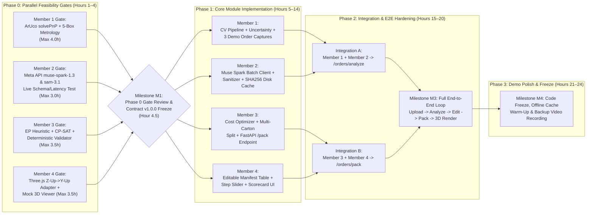

# OptiPack — Parallel Execution Plan, Phase 0 Gates, Integration & Risk Register (`03_EXECUTION_PLAN.md`)

- **Official Project Name:** OptiPack
- **Intended Audience:** All Team Members (Members 1, 2, 3, and 4) & Project Coordinator
- **Purpose:** Parallel Development Schedule, Phase 0 Feasibility Gates, Contract Freeze Governance, Cross-Module Integration Protocol, Risk Register, and Live Demo Contingency Plan
- **Contract Reference:** `01_PROJECT_SPEC.md` (`Contract v1.0.0`)

---

## 1. Execution Philosophy: Why Phase 0 Gates Come First

In a time-boxed hackathon environment, the largest cause of project failure is discovering late in integration that an upstream assumption (e.g., oblique homography accuracy, cloud API payload rules, CP-SAT solve times, or 3D coordinate alignment) fails on real inputs.

To prevent integration gridlock, OptiPack uses a **Contract-First, Gate-Driven Parallel Workflow**:
1. **Immediate Unblocking via `Contract v1.0.0`:** All 4 team members start coding simultaneously in Hour 1 against the frozen JSON schemas (`OrderAnalysisResponse`, `PackingRequest`, `PackingSolutionResponse`) defined in `01_PROJECT_SPEC.md`.
2. **Mandatory Phase 0 Proof-of-Feasibility Gate (Hours 1–4):** Before building polished production wrappers, each member executes their isolated **Phase 0 Feasibility Experiment** (`02A`–`02D`). If a primary hypothesis fails its Pass Criteria within the 3.5–4 hour time boundary, the member **immediately activates their pre-defined Fallback** without breaking the JSON contract.
3. **Golden Mock Fixtures Shared at Hour 2:** Members 1, 2, and 3 commit 3 canonical JSON fixture files to `tests/fixtures/` (`frontend/src/mocks/`) so Member 4 and the FastAPI orchestrator can test end-to-end data flows before live CV/AI/Solver tuning finishes.

---

## 2. Parallel Dependency Graph & Integration Topology

---

## 3. Master Summary of Phase 0 Feasibility Gates & Exit Criteria

| Member & Module | Phase 0 Experiment Script | Key Pass Criteria (Go) | Key Fail Trigger (No-Go) | Pre-Defined Fallback Activated on Fail | Time Limit |
| :--- | :--- | :--- | :--- | :--- | :---: |
| **Member 1** CV & Metrology | `experiments/phase0_cv_metrology.py` | ArUco pose $e_{\text{reproj}} \le 2.5\text{ px}$; Footprint $(L,W)$ MAE $\le 8\text{ mm}$; Height $H$ MAE $\le 12\text{ mm}$; CPU latency $\le 800\text{ ms}$. | Footprint MAE $> 12\text{ mm}$ OR oblique height triangulation MAE $> 20\text{ mm}$ / edge matching fails. | **Fallback 1A:** Lock to **Single Top-Down View** for $(L,W)$ + Category Aspect Prior / Mandatory UI Height Slider (`requires_user_review=true`). | **4.0 hrs** |
| **Member 2** AI & Meta API | `experiments/phase0_meta_api.py` | $100\%$ of `muse-spark-1.3` responses pass `MuseBatchOutput`; P95 latency $\le 4.0\text{ s}$; $0\%$ fabricated weights on opaque boxes. | Persistent `400/401/429` errors OR P95 latency $> 6.0\text{ s}$ OR `json_schema` fails with multi-image array. | **Fallback 2A/2B:** Single stitched composite image + JPEG downscale ($1024\text{ px}$) + SHA-256 disk cache + $3.5\text{ s}$ timeout to deterministic heuristics. | **3.0 hrs** |
| **Member 3** OR & 3D Solver | `experiments/phase0_solver_benchmark.py` | Scenarios S1–S4 solved in $\le 2.5\text{ s}$ with `validation.is_valid == True`; S4 respects max payload; S5 splits into 2 cartons cleanly. | CP-SAT times out ($> 3.0\text{ s}$) on $N \le 8$ items OR outputs floating boxes (`support_ratio < 0.60`). | **Fallback 3A:** CP-SAT with post-solve gravity drop + immediate fallback to **Tier 1 Extreme-Point Heuristic (`heuristic_ep.py`)** ($< 30\text{ ms}$, constructive $\ge 60\%$ support). | **3.5 hrs** |
| **Member 4** Frontend & 3D UI | `frontend/src/utils/__tests__/coordinateTransform.test.ts` | $0.0\text{ mm}$ floor/wall/stack alignment error across 3 mock fixtures; step slider $1 \dots N$ works; $\ge 30\text{ FPS}$ in browser. | Visual overlap/floating on valid fixtures OR React Three Fiber peer dependency / WebGL crash. | **Fallback 4A/4B:** Imperative vanilla `three` `<canvas>` wrapper (`~80` lines) + 2D orthographic Top/Front/Side SVG projection view. | **3.5 hrs** |

---

## 4. Contract Governance & Change Control Protocol

To ensure all 4 members can work in parallel without breaking each other's code:

1. **`Contract v1.0.0` is Frozen by Default:** No member may rename, delete, or change the data type or unit (`mm`, `g`, `USD`, `ms`) of any existing key in `OrderAnalysisResponse`, `PackingRequest`, or `PackingSolutionResponse` unilaterally.
2. **Additive Non-Breaking Changes (Allowed Before Milestone M1):** A member may propose adding an *optional* field with a default value (e.g., `confidence_breakdown: Optional[dict] = None`) during the Hour 4.5 Gate Review if both producer and consumer approve.
3. **Breaking Schema Changes (Requires Unanimous 4-Member Sign-Off):** If a Phase 0 failure requires changing a core field, all 4 members must pause for a 10-minute sync, bump `contract_version` to `"1.1.0"`, update `01_PROJECT_SPEC.md` and the shared mock JSON fixtures in `tests/fixtures/` first, and only then resume coding.

---

## 5. Step-by-Step Milestones & Integration Checkpoints

### Milestone M0: Repository Scaffold & Golden Fixtures (Hours 0–1)
- Initialize repository structure (`backend/app/{cv,ai,solver,api}/`, `frontend/src/`, `tests/fixtures/`, `experiments/`).
- Export the exact JSON payloads from `01_PROJECT_SPEC.md` into `tests/fixtures/order_analysis_sample.json` and `tests/fixtures/packing_solution_sample.json`.
- FastAPI server boots with stubbed `/api/v1/orders/analyze` and `/api/v1/orders/pack` returning those golden fixtures so Member 4 can hit a live local URL immediately.

### Milestone M1: Phase 0 Gate Review & Architecture Lock (Hour 4.5)
- All 4 members present their Phase 0 experiment metrics (`Pass` or `Fallback Activated`).
- Team makes final decisions on the open team assumptions (Section 8 below) and locks `Contract v1.0.0`.

### Milestone M2: Pairwise Subsystem Integration (Hours 12–15)
- **Integration Track A (`Member 1 + Member 2` $\rightarrow$ `/api/v1/orders/analyze`):**
  - Member 1's `analyze_capture_images()` produces crops and `dimensions_mm` and passes them directly in-memory to Member 2's `analyze_items_with_muse_spark()`.
  - Verify end-to-end `/api/v1/orders/analyze` completes in $\le 4.5\text{ seconds}$ on 3 real test order photo pairs and caches the responses by image SHA-256 hash.
- **Integration Track B (`Member 3 + Member 4` $\rightarrow$ `/api/v1/orders/pack`):**
  - Member 4's **"Optimize Carton & Pack"** button sends `PackingRequest` to Member 3's live `/api/v1/orders/pack` endpoint.
  - Verify that editing an item's height or toggling `keep_upright` in the UI triggers a real CP-SAT re-solve and updates the 3D viewport and cost scorecard in $\le 3.0\text{ seconds}$.

### Milestone M3: Full End-to-End Integration & Stress Testing (Hours 16–20)
- Connect Upload $\rightarrow$ `/api/v1/orders/analyze` $\rightarrow$ Editable Manifest $\rightarrow$ `/api/v1/orders/pack` $\rightarrow$ 3D Step-by-Step Viewer.
- Execute the **5 End-to-End Acceptance Test Scenarios** (Section 6 below).

### Milestone M4: Demo Rehearsal, Offline Cache Lock & Backup Recording (Hours 21–24)
- Pre-populate the SHA-256 disk cache (`backend/app/ai/cache/`) for all 3 physical demo orders so even if venue Wi-Fi drops, `/api/v1/orders/analyze` responds in $150\text{ ms}$ with real pre-verified `muse-spark-1.3` outputs.
- Record a clean, unedited 2-minute 1080p screen + webcam capture of the end-to-end flow as emergency pitch insurance.

---

## 6. End-to-End Integration Test Suite (`tests/test_e2e_pipeline.py`)

| Test ID | Scenario Name | Input Description | Expected System Behavior | Verification Check |
| :--- | :--- | :--- | :--- | :--- |
| **`E2E-01`** | **Standard 4-Item Order (Happy Path)** | Top + oblique photo pair of 4 rigid retail boxes on A4 ArUco sheet. | Calibrates (`status="calibrated"`), detects 4 items, extracts semantics via `muse-spark-1.3`, packs into `BOX-M` (`$6.87`), passes all 6 validator checks. | HTTP 200 on both endpoints; `validation.is_valid == True`; 3D UI renders 4 steps. |
| **`E2E-02`** | **Fragile + Keep Upright Override** | Same 4-item order, user toggles `keep_upright=True` on Item 1 and sets `fragility_class="high"` on Item 2. | Item 1 restricted to `["LWH", "WLH"]`; Item 2 placed at top of stack (`max_top_load_g=0`, nothing above it); re-solves in $< 2.5\text{ s}$. | `validation.fragility_check_passed == True`; `validation.rotation_check_passed == True`. |
| **`E2E-03`** | **DIM Weight vs. Heavy Payload Tradeoff** | 3 compact items whose user-entered weights total $4,200\text{ g}$ (fits `BOX-S` volume $3,000\text{ cm}^3$ if small, or `BOX-M`, but exceeds `BOX-S` max payload $3,000\text{ g}$). | Solver rejects `BOX-S` (`rejection_reason` cites `max_payload_g`), selects `BOX-M`, bills by Actual Gross Weight ($4.36\text{ kg} > 1.98\text{ kg}$ DIM). | `primary_plan.carton.carton_id == "BOX-M"`; `billable_weight_kg == 4.5`. |
| **`E2E-04`** | **Degraded Calibration / Unknown Weight Warning** | Single top-down photo where 2 ArUco markers are covered and items are unmarked brown boxes. | CV flags `requires_user_review=True` on heights; AI returns `weight_g=None, fragility_class="unknown"`; UI highlights amber review fields; operator edits height and packs successfully. | Zero unhandled exceptions; `global_warnings` populated; manual override produces valid pack. |
| **`E2E-05`** | **Multi-Carton Split (Oversized Order)** | 9 medium/large items whose combined volume exceeds `BOX-XXL` ($84,000\text{ cm}^3$). | Solver sets `single_carton_feasible=False`, packs first 6 items in `primary_plan` (`BOX-XL`) and remaining 3 items in `overflow_plans[0]` (`BOX-M`). | Both `primary_plan.validation.is_valid` and `overflow_plans[0].validation.is_valid` are `True`. |

---

## 7. Comprehensive Technical Risk Register

| Risk ID | Risk Description | Severity | Likelihood | Owner | Mitigation & Pre-Built Fallback |
| :--- | :--- | :---: | :---: | :---: | :--- |
| **`R-01`** | **Oblique Height Triangulation Error:** Textureless brown boxes lack distinct front-bottom vs. front-top corners in oblique views, causing height errors $> 20\text{ mm}$. | **High** | **Medium-High** | Member 1 | Zenith relief-corrected top-down $(L,W)$ + `requires_user_review=True` flag that highlights the height field in Member 4's UI for 1-click confirmation or preset lookup. |
| **`R-02`** | **Tabletop Shadows Merging Adjacent Contours:** Harsh overhead lighting casts shadows between boxes that merge two items into one contour. | **Medium** | **Medium** | Member 1 | Require $\ge 30\text{ mm}$ spacing between items on a dark matte surface/cloth during capture; use LAB color-channel thresholding (`b`-channel separates cardboard from neutral gray/black mat) or optional `sam-3.1` masks. |
| **`R-03`** | **Meta Model API Latency Spike or Rate Limit During Live Demo:** Live call to `muse-spark-1.3` or `sam-3.1` takes $> 5\text{ s}$ or fails on venue Wi-Fi. | **High** | **Medium** | Member 2 |1) Keep `sam-3.1` off the default critical path (`enable_cloud_sam=false`); 2) Enforce $3.5\text{ s}$ hard timeout on `muse-spark-1.3`; 3) Pre-warm SHA-256 disk cache for demo images + deterministic heuristic fallback. |
| **`R-04`** | **Hallucinated Physical Properties:** LLM guesses weights or internal fragility for sealed unmarked boxes, leading to unsafe packing claims. | **High** | **Low** (with schema guard) | Member 2 | Strict system prompt + Pydantic post-sanitizer (`sanitizer.py`) that strips unverified weights (`weight_g=null`) and forces `"unknown"` fragility to trigger UI review. |
| **`R-05`** | **CP-SAT Solver Timeout on 8+ Items with Support Constraints:** Full pairwise 2D overlap support variables slow down CP-SAT beyond $3\text{ s}$. | **Medium** | **Medium** | Member 3 | Run Tier 1 Extreme-Point Heuristic (`heuristic_ep.py`) in $< 30\text{ ms}$ first, inject as CP-SAT warm-start hint, cap CP-SAT at $2.0\text{ s}$, and fall back to Tier 1 if CP-SAT hasn't improved and passed `validate_packing_plan()`. |
| **`R-06`** | **3D Coordinate Mismatch ($Z$-Up Corner vs. Three.js $Y$-Up Center):** Rendered boxes clip into walls or float above the carton floor. | **High** | **Low** (with unit tests) | Member 4 | Enforce `mapPlacementToThreeJS()` unit tests in Phase 0 before wiring any UI state; verify against `ValidationReport`. |

---

## 8. Open Team Assumptions Requiring Confirmation at Kickoff

Before starting Phase 0 timers, the 4 team members should spend 5 minutes confirming these 5 operational assumptions:

1. **Physical Test Item Kit (`Owner: Member 1`):** Confirm which exact 6–8 physical boxes/items we have on hand at the desk right now and measure their ground-truth $(L, W, H\text{ in mm})$ and weight ($\text{g}$) with a ruler and kitchen scale.
2. **Printed A4 ArUco Sheet (`Owner: Member 1`):** Confirm access to a printer to print the A4 4-ArUco Calibration Sheet at **100% actual scale** (verify with a physical ruler that each ArUco square measures exactly $40.0\text{ mm} \times 40.0\text{ mm}$; if scaled to "Fit to Printable Area", record the exact measured millimeter span in `ARUCO_BOARD_3D_MM`).
3. **Meta Model API Key & Tier (`Owner: Member 2`):** Confirm the team's `MODEL_API_KEY` is active and decide whether to use `muse-spark-1.3-contributor` during development testing and `muse-spark-1.3` for final evaluation.
4. **Capture Mode for Live Pitch (`Owner: All`):** Decide whether the live 3-minute hackathon pitch will use **Pre-Captured Local Photo Upload** (uploading real photos taken on our test bench) + **1 Live Manual Constraint Override Re-Solve** (recommended for 100% reliability) vs. live webcam capture on stage.
5. **Deployment Target (`Owner: Member 4 & Member 3`):** Confirm local single-machine execution (`uvicorn` on `:8000` + `vite` on `:5173`) for the hackathon demo vs. cloud container hosting.
